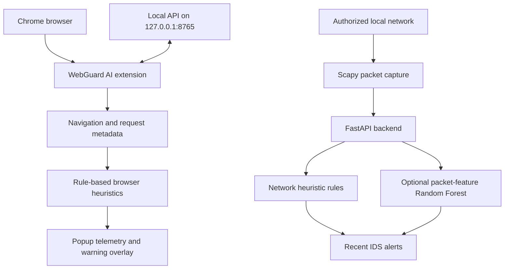

# WebGuard AI — Browser Security & Network Intrusion Monitoring

<p align="center">
  <strong>An educational cybersecurity prototype combining browser activity heuristics with local network traffic monitoring.</strong>
</p>

<p align="center">
  
  
  
  
  
</p>

> **Project status: In development.** WebGuard AI is a student project and an educational prototype—not a production security product. Alerts are indicators that require investigation, not proof that a website is malicious or a device is compromised.

## Overview

WebGuard AI explores two complementary areas of defensive security:

- **Browser activity monitoring:** a Chrome Manifest V3 extension collects navigation/request metadata and applies explainable, rule-based heuristics to highlight potentially unusual website activity.
- **Local network intrusion monitoring:** a Python FastAPI service can use Scapy to observe authorized local network traffic and raise heuristic alerts for patterns such as possible port sweeps, TCP SYN bursts, and unusually high packet rates.

The two components currently produce separate signals. The browser extension does **not** use a trained machine-learning model to classify websites. The optional Random Forest pipeline applies only to the backend's documented packet-feature schema.

## Architecture



## Current capabilities

| Component | Implemented functionality |
|---|---|
| Chrome extension | Manifest V3; per-tab navigation and completed-request metadata |
| Browser telemetry | Request count/rate, unique domains, and third-party request ratio over a rolling 60-second window |
| Browser heuristics | Explainable hostname and activity indicators; in-page warning when the combined score is high |
| Local network IDS | Optional Scapy capture through a local FastAPI service |
| Network heuristics | Possible port-sweep, TCP SYN-burst, and high-packet-rate alerts |
| ML training baseline | Optional Random Forest training pipeline for the documented packet-feature CSV schema |
| API | Health, status, capture start/stop, and recent-alert endpoints |

## Technology stack

- **Browser:** JavaScript, Chrome Extensions Manifest V3, HTML, CSS
- **Backend:** Python, FastAPI, Uvicorn, Scapy
- **Machine learning:** pandas, scikit-learn, joblib
- **Network representation/testing:** packet metadata and a local request-telemetry test page

## Repository structure

```text
Web-IDS-AI-Browser-Extension/
├── extension/
│   ├── background/       # Browser event collection and heuristics
│   ├── content/          # In-page warning overlay
│   └── popup/            # Extension dashboard
├── backend/
│   ├── main.py           # Local FastAPI + Scapy network IDS
│   ├── requirements.txt
│   └── ml/
│       ├── train_model.py
│       └── README.md
├── test-site/            # Local request-volume test page
└── README.md
```

## Setup and usage

### Requirements

- Windows 10/11, macOS, or Linux
- Python 3.11 or newer (Python 3.11–3.13 are the recommended tested range for this dependency set)
- Google Chrome or another Chromium browser with Manifest V3 support
- Npcap on Windows for Scapy packet capture; capture may require Administrator privileges

### 1. Start the backend (Windows PowerShell)

Open PowerShell in the `backend` directory:

```powershell
py -3.11 -m venv .venv
.\\.venv\\Scripts\\Activate.ps1
python -m pip install --upgrade pip
python -m pip install -r requirements.txt
python -m uvicorn main:app --host 127.0.0.1 --port 8765
```

Check the service:

- http://127.0.0.1:8765/health
- http://127.0.0.1:8765/api/status

Use a second PowerShell window to inspect capture and alerts:

```powershell
Invoke-RestMethod -Method Post -Uri http://127.0.0.1:8765/api/capture/start -ContentType 'application/json' -Body '{}'
Invoke-RestMethod -Uri http://127.0.0.1:8765/api/status
Invoke-RestMethod -Uri http://127.0.0.1:8765/api/alerts
Invoke-RestMethod -Method Post -Uri http://127.0.0.1:8765/api/capture/stop
```

Packet capture depends on the selected interface and operating-system permissions. If capture fails, inspect `capture_error` in `/api/status`.

### 2. Load the Chrome extension

1. Open `chrome://extensions`.
2. Enable **Developer mode**.
3. Click **Load unpacked**.
4. Select the repository's `extension` folder.
5. Open a website and click the WebGuard AI icon to view its telemetry.

The extension communicates with the backend through `127.0.0.1:8765`. Browser telemetry and packet capture are separate functions; the extension cannot observe every packet on the computer.

### 3. Optional: train the packet-feature model

No trained model is included. The training script expects a labelled CSV with these numeric columns:

```text
Length,TTL,Protocol,IsTCP,IsUDP,IsICMP,Label
```

Run from the `backend` directory:

```powershell
python ml/train_model.py path\\to\\your_features.csv
```

The script performs a stratified hold-out split, reports precision, recall, F1 and a confusion matrix, and saves the model to `backend/ml/webguard_rf.joblib`. Restart the API after training.

**Dataset compatibility:** CIC-IDS2017/2018 are flow-oriented datasets; their raw columns do not directly match this packet-level schema. A documented feature extraction/mapping step is needed. For stronger evaluation, avoid random-row leakage where possible by splitting by capture, time, or host, and report false-positive rate and detection latency as well as precision, recall, and F1.

### 4. Local browser telemetry test

The `test-site` folder contains a page that generates a sequence of requests to its own local server. This checks whether the extension records request activity; it does **not** simulate malware or validate malicious-site detection.

From the `test-site` directory:

```powershell
py -m http.server 8000 --bind 127.0.0.1
```

Then open http://127.0.0.1:8000 in Chrome with the extension loaded.

## API endpoints

| Method | Endpoint | Purpose |
|---|---|---|
| GET | `/health` | Service health |
| GET | `/api/status` | Capture and model status |
| POST | `/api/capture/start` | Start authorized local capture; optional JSON `{"interface":"..."}` |
| POST | `/api/capture/stop` | Stop capture |
| GET | `/api/alerts?limit=100` | Retrieve recent alerts |
| DELETE | `/api/alerts` | Clear recent alerts |

## Limitations and development roadmap

### Known limitations

- Hostname wording, subdomain structure, request rate, and third-party request ratios are weak signals. Legitimate sites may trigger them, and malicious sites may avoid them.
- The extension does not currently query a threat-intelligence feed, inspect page content for phishing, validate certificates, or run a trained website-classification model.
- HTTPS payloads are encrypted. The backend does not decrypt TLS traffic or inspect full application-layer request bodies.
- Network rules are heuristic and can produce false positives. A suspected scan or SYN burst is not conclusive evidence of an attack.
- The optional Random Forest is a packet-level baseline, not a pretrained model. Its usefulness depends on representative labelled data and independent evaluation.
- Browser heuristic scores and backend IDS alerts are not combined into a single AI confidence score.

### Planned improvements

- Build controlled, repeatable test cases for browser and network detections.
- Improve feature engineering and document dataset preparation.
- Evaluate precision, recall, F1, false-positive rate, and detection latency.
- Test alert deduplication and document known false positives.
- Keep heuristic indicators clearly separated from machine-learning predictions.

## Responsible use

Use packet capture only on devices and networks you own or have explicit permission to monitor. Keep the backend bound to loopback (`127.0.0.1`); do not expose it to a public or shared network for demonstrations. Do not use this project to scan, stress, or probe third-party systems.
